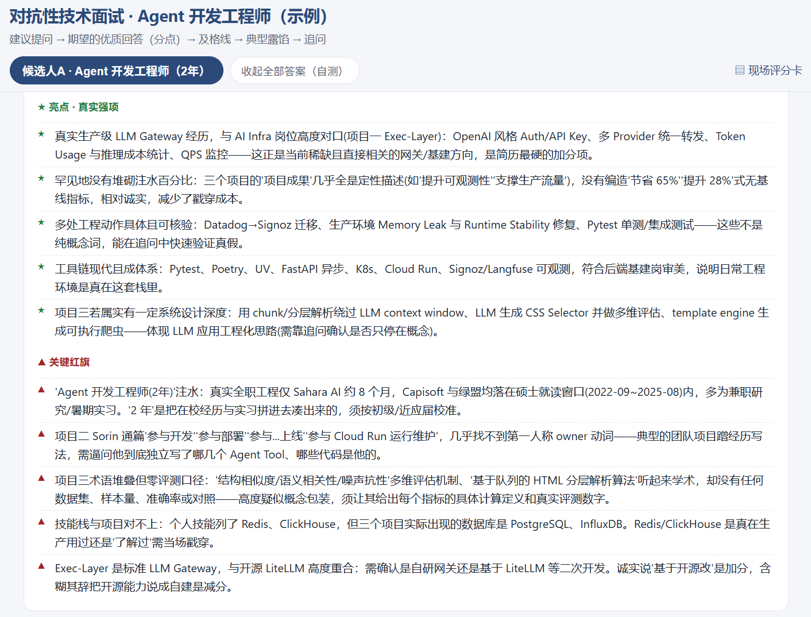
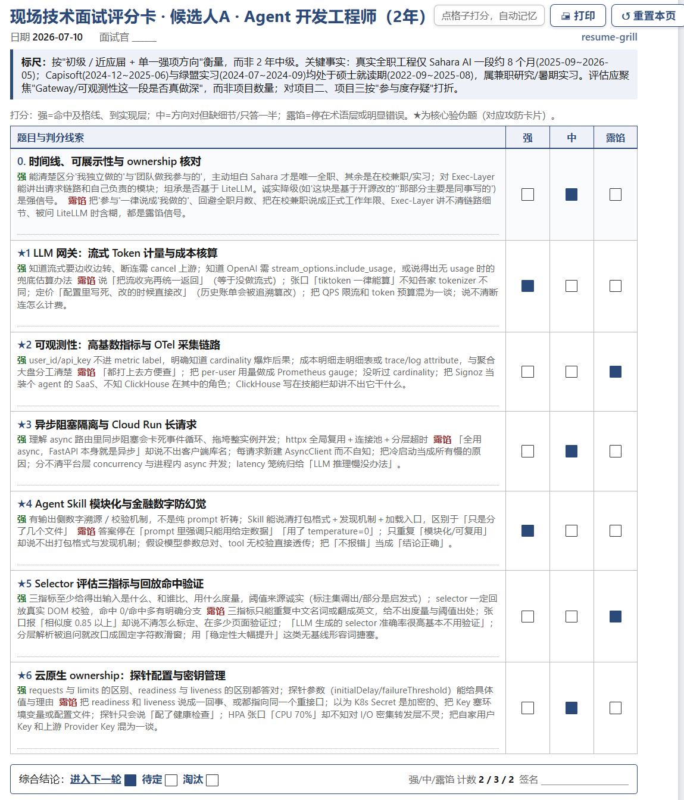

# resume-grill

[Chinese](README.md) | [English](README.en.md)

An Agent Skill for grilling resumes: feed it one or more resume PDFs and it produces a three-piece interview kit: an interview guide, a printable scorecard, and Q&A attack-defense cards. Questions start from the candidate's real projects and escalate layer by layer. Answer keys are fact-checked. The evaluation is balanced and candid: it exposes inflated claims while still recognizing real strengths, without forcing symmetrical pros and cons. **Output language follows the resume automatically**: Chinese resumes produce Chinese materials, English resumes produce English materials. It can run in Claude Code or any agent framework.

> This repository includes a **fully anonymized** demo resume for a fictional candidate, "Zhang San", applying for an Agent / AI Infra role with 2 years of experience. See the generated kit: [guide](examples/agent_engineer_demo/agent_engineer_demo_guide.md), [scorecard](examples/agent_engineer_demo/agent_engineer_demo_scorecard.html), and [Q&A cards](examples/agent_engineer_demo/agent_engineer_demo_qa_cards.html). Open the HTML files in a browser.






## Quick Start

**1. Install once** with a cross-platform command. No PowerShell required:

```bash
python scripts/install.py
```

The installer copies the skill into detected agents, such as Claude Code and Codex. Rerun it after changing the skill.

**2. Use it** by opening a fresh session in the agent, dragging a resume PDF into the conversation, and saying "grill this resume". For multiple candidates, drag in all resumes together. The agent ingests the files into the workspace, runs the pipeline, and returns local links to the generated kit, so you do not have to hunt through folders.

Outputs are written to `workspace/output/<slug>/`: `_qa_cards.html` for reading and self-testing, `_scorecard.html` for A4 printing and live scoring, and `_guide.md` for deeper interview prep.


## Outputs

The three files are written to the same directory, link to each other with local relative paths, and are fully self-contained. They can be opened directly via `file://`.

- **Full guide** `<slug>_guide.md` - candidate profile and credibility, real strengths, key red flags, opening attitude questions, and core verification questions. Each question includes an L1 project entry point, L2 design-decision probe, L3 hard verification probe, expected strong-answer points, pass line, common tells, and follow-ups.
- **Live scorecard** `<slug>_scorecard.html` - one A4 page per candidate, with Strong / Medium / Exposed checkboxes and scoring clues for every question. Ready to print and use during the interview.
- **Q&A cards** `<slug>_qa_cards.html` - candidate tabs, one-click answer folding for self-testing, colored sections for strengths, red flags, and layered probes, plus links back to each candidate's original resume PDF.

The engine is an adaptive multi-stage workflow: read the resume, triage the profile, strengths, red flags, and technical domains to probe, generate domain-specific grilling questions, converge on project-grounded layered verification questions with answer keys, then fact-check and revise. It works for arbitrary roles and resumes without hand-writing a new question set for every candidate.


## Agent Installation

`SKILL.md` follows the cross-agent skill format. The same skill directory can be recognized by multiple agents and triggered from natural language. `install.py` installs into every detected agent by default, or into a specific target:

| Command | Target |
| --- | --- |
| `python scripts/install.py` | Automatic: all detected agents |
| `python scripts/install.py --claude` | `~/.claude/skills/resume-grill` for Claude Code / Claude.ai / Agent SDK |
| `python scripts/install.py --codex` | `~/.codex/skills/resume-grill` for Codex CLI |
| `python scripts/install.py --all` | All of the above |
| `python scripts/install.py --target <dir>` | Any agent skills directory |

After installation, open a fresh session in that agent and trigger it naturally, for example with "grill this resume". For frameworks without skill support, use the pure-script path below.


## Languages

Output language is detected by default and follows the resume: Chinese resumes produce Chinese materials, English resumes produce English materials, including the UI labels in the scorecard and cards. To force a language, ask the agent to output in English, or pass `--lang en` in script mode. Supported values are `zh`, `en`, an ISO language code, or `auto`. The UI shell has built-in Chinese and English labels. For other languages, the main content uses that language while UI labels fall back to English. To add another UI language, add an entry to `LABELS` in `scripts/render.py`.


## Scripts / Any Framework

The analysis logic is decoupled from Claude Code's Workflow runtime. You can run the same pipeline with three script commands and get the same output structure:

```bash
python scripts/extract_pdf.py workspace/inbox/resume.pdf --out resumes.json
# Model backend: RG_LLM_PROVIDER=openai|anthropic|custom. See the header of analyze_portable.py.
RG_LLM_PROVIDER=openai python scripts/analyze_portable.py --resumes resumes.json --out payload.json
python scripts/render.py payload.json workspace/output/demo demo
```

`analyze_portable.py` only needs a structured-output callback shaped as `call_llm(system, user, schema)`. It includes OpenAI and Anthropic adapters, and can be wired to your own model. If your orchestration stack is limited, add `--single` to produce the whole payload in one model call, with slightly less depth but the same structure. The runtime-neutral four-stage contract, including stages, prompts, and JSON schemas, lives in `reference/pipeline-spec.md`. The rendering layer, `render.py` plus templates, has zero dependencies and can render any compatible `payload.json`.


## Project Structure

```text
resume-grill/
  SKILL.md                     Skill entry point: frontmatter plus instructions
  scripts/
    extract_pdf.py             Resume PDF to text
    analyze.js                 Claude Code native multi-agent Workflow engine
    analyze_portable.py        Runtime-neutral reference orchestration plus --single fallback
    render.py                  payload.json to the three-piece kit, zero dependencies, with UI i18n
    install.py                 Cross-platform installer for agent skills directories
  templates/                   Self-contained HTML templates for cards and scorecards
  reference/
    pipeline-spec.md           Runtime-neutral pipeline contract: stages, prompts, schema, language
    writing-norms.md           Output writing norms by language
  workspace/                   Local workspace, ignored by git
    inbox/  output/  BG/
```


## Privacy

Resumes contain sensitive personal information. Please anonymize files before uploading them. `workspace/`, including resumes and generated outputs, is excluded by `.gitignore`, and `*.pdf` has an additional global ignore rule, so private resumes are not committed when publishing the repository.


## License

MIT License