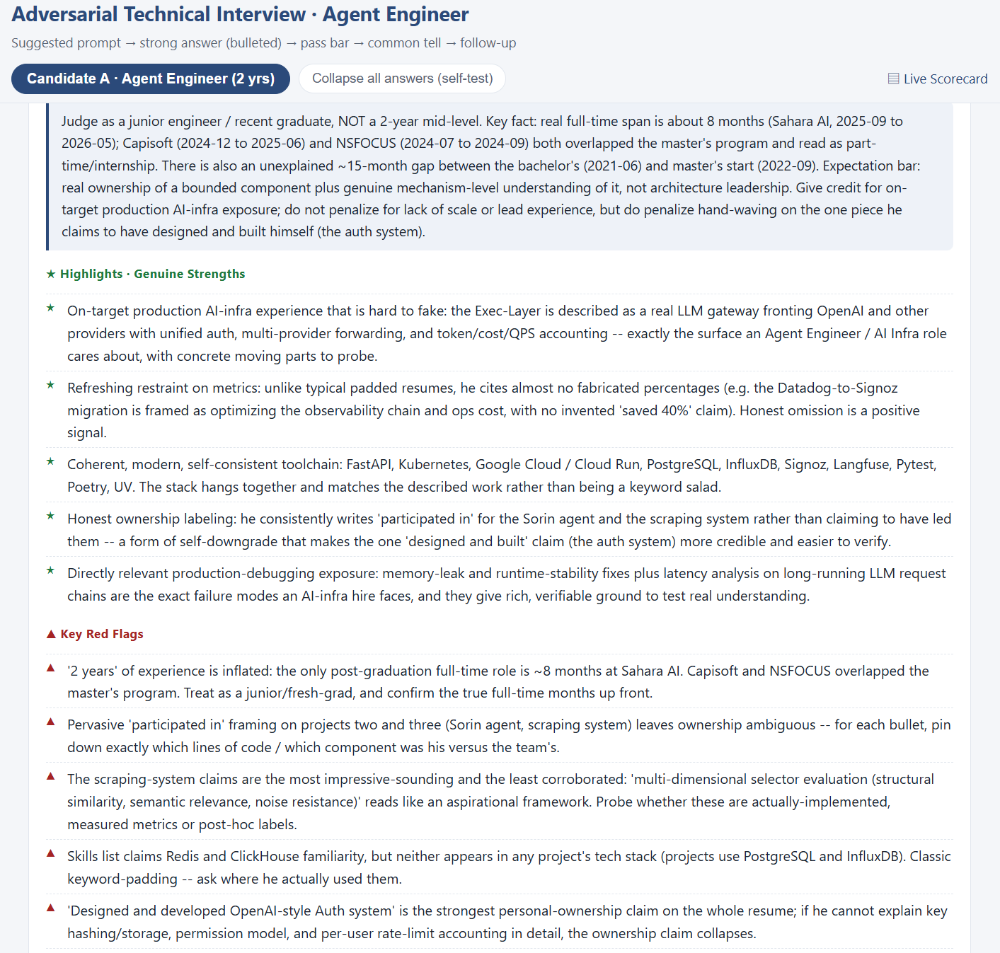
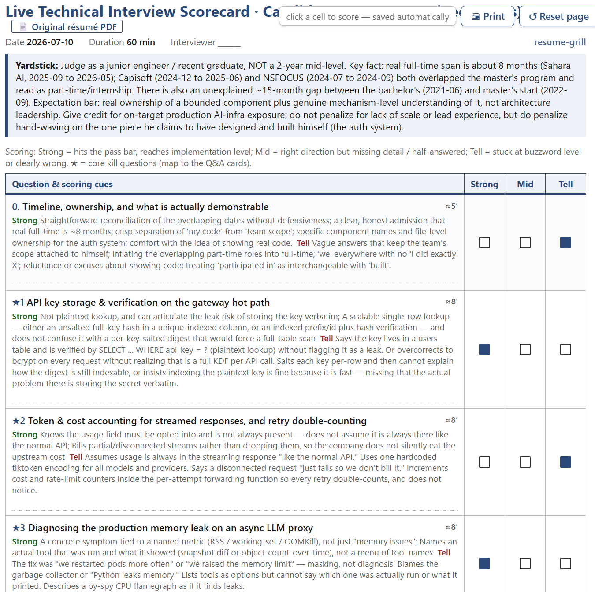

# resume-grill · 简历拷打

[English](README.md) | [中文](README.zh-CN.md)

**Resume-based interview prep, for candidates and interviewers.** Grill a resume into an interviewer kit with deep questions, model answers and live scoring, find its weak points, optimize it without inventing facts, or check it against a job description. Each mode starts with one sentence, takes follow-up questions in the chat, and produces self-contained HTML pages that export to PDF.

```bash
npx skills add JinChengZ18/resume-grill
```

In its default grilling mode, this Agent Skill turns each resume into an interviewer kit: one self-contained page organized as before, during and after the interview. Questions form project-based themes that ask about principles, trade-offs, failure attribution and evaluation rather than trivia; each question is followed directly by what to listen for (pass line marked) and a folded spoken model answer, with no jump links. Tell it about the hiring team (for example “we use AI for digital chip back-end design”) and each theme gets a situational question that moves the candidate’s approach into that setting, with unfamiliar terms explained in parentheses. After the interview, score each dimension against 4/3/2/1 anchors and generate a review draft. For research and senior roles, discussion emphasizes significance, alternative approaches, tradeoffs, and evidence. Output language follows the resume. Runs in Claude Code, Codex, claude.ai, and other agents that read `SKILL.md`.

> This repository includes a **fully anonymized** demo resume for a fictional candidate, "Zhang San", applying for an Agent / AI Infra role with 2 years of experience. Start from the [index](examples/agent_engineer_demo/agent_engineer_demo_index.html), or open a page directly: [interviewer kit](examples/agent_engineer_demo/agent_engineer_demo_kit_A.html), [weakness analysis](examples/agent_engineer_demo/agent_engineer_demo_weakness.html), [resume optimization](examples/agent_engineer_demo/agent_engineer_demo_resume.html), and [JD match](examples/agent_engineer_demo/agent_engineer_demo_jd.html) (against a sample JD written for the demo). Open the HTML files in a browser.


## Modes

| Mode | Start it with one sentence | Pages |
| --- | --- | --- |
| Grill (default) | "grill this resume", "interview questions from this resume", "full audit of this resume" | `_kit_<id>.html` (one interviewer kit per candidate) |
| Weakness analysis | "what are the weak points in my resume", "where will interviewers push back" | `_weakness.html` |
| Resume optimization | "optimize my resume", "rewrite my resume bullets for interviews" | `_resume.html` |
| JD match | "check my resume against this JD", with the JD text or link | `_jd.html` |

- **Candidates** grill their own resume before an interview, see where an interviewer is likely to push, and fix weak metrics, unclear ownership and timeline gaps in advance. **Interviewers** generate a 30/60/90-minute structured technical interview from a candidate's resume, with what to listen for and a folded model answer under each question, a timer, dimension scoring and a review draft.
- **Follow-ups**: ask about any item ("how should I answer W2?", "rewrite the first job for a backend role", "here are my real numbers") and the same pages are updated in place, so the links stay valid. Resume optimization asks you for missing facts in one go and never invents numbers; unknown facts stay highlighted as placeholders until you supply them.
- **Combine modes** in one sentence, such as "grill and optimize this resume" or "the full set" (grilling, weakness analysis and optimization, plus JD match when you give a JD).
- Chinese requests work the same way: 「拷打这份简历」「分析这份简历的弱点」「帮我优化简历」「对照这个JD看看我的简历」.


## Quick Start

**1. Install once** with any of these:

| Method | Command | Notes |
| --- | --- | --- |
| skills CLI | `npx skills add JinChengZ18/resume-grill` | Installs into Claude Code, Codex, Cursor, and other agents; add `-g` for a global install |
| Claude Code plugin | `/plugin marketplace add JinChengZ18/resume-grill`, then `/plugin install resume-grill@resume-grill` | Installs as a plugin |
| Clone and install | `python scripts/install.py` | Cross-platform, no PowerShell required; copies the skill into detected agents such as Claude Code and Codex. Rerun it after changing the skill |

**2. Use it** by opening a fresh session in the agent, dragging a resume PDF into the conversation, and saying one of the sentences above, such as "grill this resume". For multiple candidates, drag in all resumes together. The agent ingests the files into the workspace, runs the pipeline, and returns local links starting with the index page, so you do not have to hunt through folders.

Outputs are written to `workspace/output/<slug>/`, where `<slug>_index.html` lists every page; each interviewer kit also works as a single file. Each page has an **Export PDF** button, which opens the browser's print dialog; choose "Save as PDF".


## Outputs

All pages are written to the same directory and are fully self-contained, so they open directly via `file://` and print to A4.

- **Index** `<slug>_index.html`: every page for every candidate.
- **Interviewer kit** `<slug>_kit_<id>.html`, one per candidate, with no links to other pages. *Before*: a one-line profile (yardstick and profile folded), the questions this interview must answer, what to verify and where, the time plan, strengths and notes; the resume is embedded. *During*: the opener, each theme and the wrap-up; every question is followed by what to listen for (★ = pass line, tickable) and a folded model answer, situational questions and probes show when to ask them, and each theme ends with danger signals and a notes box. *After*: score each dimension 4/3/2/1, see the suggested verdict, and generate a review draft from your ticks and notes. Long text is folded; the header has a timer, Expand all and Export PDF, and printing outputs only what is expanded. Ticks and notes stay in your browser.
- `<slug>_guide.md` keeps the full content as plain text. The older interview guide, Q&A cards and A4 scorecard are still available: add `"views": ["guide", "cards", "scorecard"]` to `meta`.
- **Weakness analysis** `<slug>_weakness.html`: weak points ordered by severity, each with the resume quote, how an interviewer reads it, likely follow-ups with model answers, and a fix.
- **Resume optimization** `<slug>_resume.html`: the facts the agent still needs from you, before/after rewrites with reasons, and an optimized resume that exports on its own as a clean PDF.
- **JD match** `<slug>_jd.html`: requirement-by-requirement status with resume evidence, keyword coverage, a plan for each gap, and likely interview questions. There is no made-up overall score; statuses are counted instead.

The three extra modes are written by the agent against `reference/modes-spec.md`; `analyze.js` and `analyze_portable.py` implement the grilling pipeline.

The workflow reviews the resume, develops domain-specific topics, writes coherent themes and spoken responses, then verifies and revises them. Review covers technical accuracy, question continuity, response alignment, and evidence boundaries. Well-supported alternative approaches are welcome. Working arrangements and material checks remain separate.

The screenshots and linked examples below use the legacy format. Newly generated kits use theme-local follow-ups and paired spoken responses.






## Agent Installation

`SKILL.md` follows the cross-agent skill format. The same skill directory can be recognized by multiple agents and triggered from natural language. `install.py` installs into every detected agent by default, or into a specific target:

| Command | Target |
| --- | --- |
| `python scripts/install.py` | Automatic: all detected agents |
| `python scripts/install.py --claude` | `~/.claude/skills/resume-grill` for Claude Code / Claude.ai / Agent SDK |
| `python scripts/install.py --codex` | `~/.codex/skills/resume-grill` for Codex CLI |
| `python scripts/install.py --all` | All of the above |
| `python scripts/install.py --target <dir>` | Any agent skills directory |

After installation, open a fresh session in that agent and trigger it naturally, for example with "grill this resume". For frameworks without skill support, use the pure-script path below.


## Languages

Output language is detected by default and follows the resume: Chinese resumes produce Chinese materials, English resumes produce English materials, including the UI labels in the interviewer kit and other pages. To force a language, ask the agent to output in English, or pass `--lang en` in script mode. Supported values are `zh`, `en`, an ISO language code, or `auto`. The UI shell has built-in Chinese and English labels. For other languages, the main content uses that language while UI labels fall back to English. To add another UI language, add an entry to `LABELS` in `scripts/render.py`.


## Interview Length & Full-Audit Mode

Specify a duration, or use the 60-minute default. The table is a coverage guide: prioritize substantive discussion over asking every question, and leave unasked items unscored.

| Length | Core questions | What changes |
| --- | --- | --- |
| 30 min | 3 (≈7′ each) | Warm-up ladder drops to 1 rung; answer keys stay tight |
| 60 min | 6 (≈8′) | Default |
| 90 min | About 9 themes (about 8 min each) | More discussion of alternatives and evidence; follow-ups remain inside their theme |

**Full-audit mode (ultra).** Say "do a full review of this resume", "audit it thoroughly", "find every weak point", or "what will I get asked", and it drops the time box and the question cap, digging out every point in the resume that an interviewer could challenge: every red flag, every percentage without a baseline, every vague "participated in / responsible for" ownership claim, every technology listed under skills but absent from the projects, every overlapping timeline, every coursework project dressed up as a "system". Typically 12-24 questions, erring on the side of more — but only for doubts that genuinely exist in the resume; it will not invent them. Interviewers use it to dig deep; candidates work through the fold-away answers on the Q&A cards and patch the holes before the interview. The switch is decided by whether you want exhaustive coverage, not by who is asking.


## Scripts / Any Framework

The analysis logic is decoupled from Claude Code's Workflow runtime. You can run the same pipeline with three script commands and get the same output structure:

```bash
python scripts/extract_pdf.py workspace/inbox/resume.pdf --out resumes.json
# Model backend: RG_LLM_PROVIDER=openai|anthropic|custom. See the header of analyze_portable.py.
RG_LLM_PROVIDER=openai python scripts/analyze_portable.py --resumes resumes.json --out payload.json
python scripts/render.py payload.json workspace/output/demo demo
```

`analyze_portable.py` only needs a structured-output callback shaped as `call_llm(system, user, schema)`. It includes OpenAI and Anthropic adapters, and can be wired to your own model. If your orchestration stack is limited, add `--single` to produce the whole payload in one model call, with slightly less depth but the same structure. The runtime-neutral four-stage contract, including stages, prompts, and JSON schemas, lives in `reference/pipeline-spec.md`. The rendering layer, `render.py` plus templates, has zero dependencies and can render any compatible `payload.json`.


## Project Structure

```text
resume-grill/
  SKILL.md                     Skill entry point: frontmatter plus instructions
  .claude-plugin/
    plugin.json                Plugin manifest for Claude Code and Anthropic's plugin directory
    marketplace.json           Single-plugin marketplace for /plugin marketplace add
  scripts/
    extract_pdf.py             Resume PDF to text
    analyze.js                 Claude Code native multi-agent Workflow engine
    analyze_portable.py        Runtime-neutral reference orchestration plus --single fallback
    render.py                  payload.json to linked HTML pages, zero dependencies, with UI i18n
    pages.py                   Index, HTML guide, weakness, resume and JD pages
    kit.py                     Interviewer kit, one self-contained page per candidate
    install.py                 Cross-platform installer for agent skills directories
  templates/                   Self-contained HTML templates and shared page.css
  reference/
    pipeline-spec.md           Runtime-neutral pipeline contract: stages, prompts, schema, language
    modes-spec.md              Weakness analysis, resume optimization and JD match: rules and schema
    writing-norms.md           Output writing norms by language
  workspace/                   Local workspace, ignored by git
    inbox/  output/  BG/
```


## Privacy

It is recommended to remove any personal information from your resume to avoid potential data leakage risks associated with API service providers. `workspace/`, including resumes and generated outputs, is excluded by `.gitignore`, and `*.pdf` has an additional global ignore rule, so private resumes are not committed when publishing the repository.

While the skill runs, inputs, intermediate files, and outputs stay under `workspace/`. Apart from your agent's own model calls, the scripts make no network requests; resume text goes to a model provider only if you run `analyze_portable.py` with `RG_LLM_PROVIDER` set.


## License

MIT License
