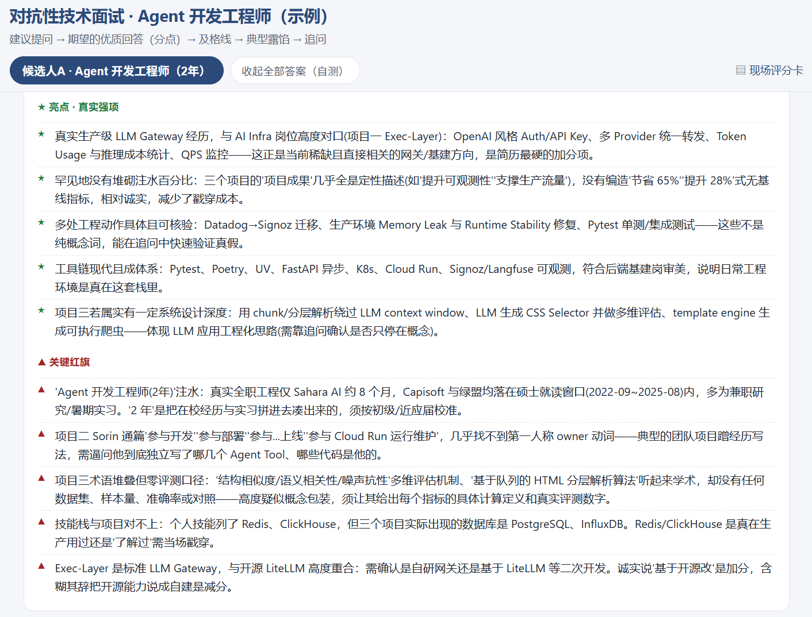
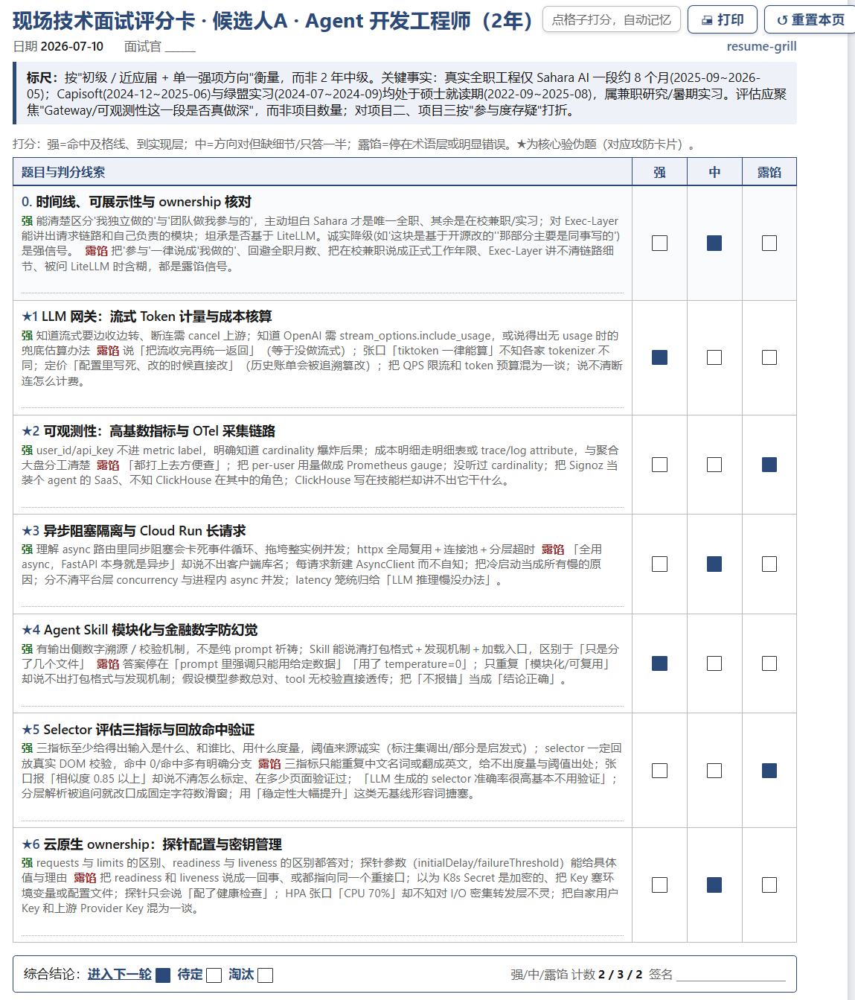

# resume-grill · 简历拷打

[English](README.md) | [中文](README.zh-CN.md)

**拿简历做面试准备的 Agent Skill，求职者和面试官都能用。** 四种模式：把简历拷打成面试官手册（有深度的问题、示范回答、现场打分）、找出简历弱点、在不编造事实的前提下优化简历、对照JD看匹配。每种模式一句话启动，可以在对话里继续追问，产物是自包含、可导出PDF的HTML页面。

```bash
npx skills add JinChengZ18/resume-grill
```

默认的面试拷打模式为每位候选人生成一份面试官手册：一个自包含页面，按面试前、面试中、面试后组织。问题按项目组织成连贯主题，问原则与取舍、失败归因和评估方法，不问能背下来的细节；每道题下面紧跟“要听的点”（标出及格线）和折叠的示范回答，页面内没有跳转链接。说明招聘方背景（例如“我们用AI做数字芯片后端设计”）后，每个主题都有一道迁移情境题，把候选人的做法放到这个场景里推演，对方可能不懂的术语用括号解释。面试后按4/3/2/1锚点给各维度打分，并生成面评草稿。研究与高级技术岗位重点讨论问题意义、路线选择、取舍与证据，具体上下文用于支撑判断。支持 Claude Code、Codex、claude.ai 等读取 `SKILL.md` 的 agent，输出语言默认跟随简历。

> 展示一份**完全脱敏**的示例简历（虚构「张三」，某 Agent / AI Infra 岗，2 年经验）跑出的真实产物：从[总入口](examples/agent_engineer_demo/agent_engineer_demo_index.html)进入，或直接打开[面试官手册](examples/agent_engineer_demo/agent_engineer_demo_kit_A.html)、[弱点分析](examples/agent_engineer_demo/agent_engineer_demo_weakness.html)、[简历优化](examples/agent_engineer_demo/agent_engineer_demo_resume.html)、[JD匹配](examples/agent_engineer_demo/agent_engineer_demo_jd.html)（对照为演示编写的示例JD）。html 用浏览器打开。
>


## 工作模式

| 模式 | 一句话启动 | 页面 |
| --- | --- | --- |
| 面试拷打（默认） | 「拷打这份简历」「根据简历出面试题」「全面审查这份简历」 | `_kit_<id>.html`（每人一份面试官手册） |
| 弱点分析 | 「分析这份简历的弱点」「我的简历哪里会被问住」 | `_weakness.html` |
| 简历优化 | 「帮我优化这份简历」「按面试标准改写简历」 | `_resume.html` |
| JD匹配 | 「对照这个JD看看我的简历」，附JD文字或链接 | `_jd.html` |

- **求职者**面试前拷打自己的简历，预测面试官会从哪里追问，提前处理量化结果、本人贡献、时间线里的漏洞；**面试官**按候选人简历生成 30/60/90 分钟的结构化技术面试，每问附要听的点和折叠的示范回答，带计时、维度打分和面评草稿。
- **追问**：对任何一条接着问（「W2 怎么回答更好」「把第一段经历往后端方向改」「这是我的真实数字……」），同一批页面原地更新，链接不变。简历优化缺少的事实会一次问完，绝不编造数字；没补充的事实保持黄色占位符。
- **组合模式**：一句话就能组合，如「拷打并优化这份简历」「全套」（面试拷打、弱点分析与简历优化，给了JD时再加JD匹配）。
- 英文说法同样可以，如 "grill my resume"、"optimize my resume"、"check my resume against this JD"。


## 快速开始

**1. 装一次**——任选一种：

| 方式 | 命令 | 说明 |
| --- | --- | --- |
| skills CLI | `npx skills add JinChengZ18/resume-grill` | 装进 Claude Code、Codex、Cursor 等 agent；加 `-g` 装到全局 |
| Claude Code 插件 | `/plugin marketplace add JinChengZ18/resume-grill`，再 `/plugin install resume-grill@resume-grill` | 以插件形式安装 |
| 克隆后安装 | `python scripts/install.py` | 跨平台，无需 PowerShell；自动装进检测到的 agent（Claude Code / Codex …），改完技能后重跑一次即可 |

**2. 用**——装完新开一个会话，把简历 PDF **直接拖进对话**，说一句上面表格里的话即可，例如「拷打这份简历」（多份就都拖进来）。Agent 会自动把文件纳入工作区、跑完流水线，并**直接回给你从总入口开始的本地链接**，不用翻文件夹。

产物在 `workspace/output/<slug>/`，`<slug>_index.html` 列出所有页面；每份面试官手册也可以单独打开使用。每页都有 **导出PDF** 按钮，会打开浏览器的打印窗口，选「另存为 PDF」即可。


## 产物说明

所有页面写进同一目录、完全自包含（可直接 `file://` 打开），可打印为 A4：

- **总入口** `<slug>_index.html`：每位候选人的全部页面。
- **面试官手册** `<slug>_kit_<id>.html`：每人一份，页面内不跳转。*面试前*：一句话画像（标尺与画像折叠）、这场面试要回答的问题、先核实的事项及在哪一问核实、时间安排、优势与注意事项，原始简历嵌入页面。*面试中*：开场、各主题与收尾；每道题下面紧跟要听的点（★为及格线，可勾选）和折叠的示范回答，情境题和追问标出选问条件，主题末尾是危险信号和记录框。*面试后*：各维度按4/3/2/1打分，页面给出建议结论，并根据勾选和记录生成面评草稿。大段文字一律折叠；页头可计时、展开全部、导出PDF，打印只输出已展开的内容；记录保存在本机浏览器。
- `<slug>_guide.md` 以纯文本保存全部内容。旧版面试指南、问答卡片与A4评分卡仍可生成：在 `meta` 里加 `"views": ["guide", "cards", "scorecard"]`。
- **弱点分析** `<slug>_weakness.html`：按严重程度排列的薄弱点，每条附简历原文、面试官会怎样理解、可能的追问与示范回答、修改建议。
- **简历优化** `<slug>_resume.html`：还需要你补充的事实、逐条改前改后对照和理由，以及可单独导出成 PDF 的优化版简历。
- **JD匹配** `<slug>_jd.html`：逐条对照岗位要求的状态和简历证据、关键词覆盖、每个缺口的补强计划与可能的面试问题。不给凭空的总分，只统计各状态的数量。

三种扩展模式由 agent 按 `reference/modes-spec.md` 撰写；`analyze.js` 与 `analyze_portable.py` 实现的是面试拷打流水线。

流程为简历研判、分域选题、主题与示范回答撰写、核查及修订。核查同时覆盖技术准确性、问题衔接、逐问回答与事实边界。不同且有依据的路线同样可以得分。合作安排与材料确认独立列出。

以下截图及链接示例来自旧版，用于展示历史格式；新生成材料使用主题内追问和逐问示范回答。






## 多语言

产物语言默认自动判定，与简历一致——中文简历出中文、英文简历出英文，连面试官手册与各页面的界面文案也随之本地化。想强制某种语言：让 Claude「用英文输出」，或纯脚本加 `--lang en`（值为 `zh`/`en`/ISO 码/`auto`）。界面壳内置中英两套；指定其它语言时正文用该语言、界面文案回退英文（新增一门语言只需给 `scripts/render.py` 的 `LABELS` 加一条目）。


## 面试时长与全面审查

可指定面试时长，未指定时默认60分钟。下表是覆盖量参考；讨论质量优先于问完所有问题，未问部分留空。

| 时长 | 核心题 | 深度变化 |
| --- | --- | --- |
| 30 分钟 | 3 题（每题 ≈7′） | 暖场阶梯只留 1 级、答案键写精不写多 |
| 60 分钟 | 6 题（≈8′） | 默认 |
| 90分钟 | 约9个主题（约8分钟） | 增加路线比较与证据讨论，追问仍归属原主题 |

**全面审查（ultra）**：说一句「全面审查这份简历」「彻底排查一遍」「找出所有疑点」，它就不设时间盒、不设题数上限，把简历里每一处可能被追问的地方都挖出来——每条红旗、每个没有基线的百分比、每处「参与/负责」的 ownership 模糊、每个只写在技能栏却无项目佐证的术语、每段时间线重叠、每个被包装成「系统」的课程项目。通常 12-24 题，宁多勿漏；但只针对简历里**真实存在**的疑点，不编造。面试官拿它逐条深挖；候选人拿攻防卡片的折叠自测逐题过一遍，面试前把窟窿补上。切换判据是「要不要穷尽」，不是谁在用。


## 装到哪个 agent（Codex / Claude Code / 其它）

`SKILL.md` 是跨 agent 通用标准，同一个技能目录在多种 agent 里都能直接识别、按描述模糊触发。`install.py` 默认装进所有检测到的 agent，也可指定：

| 命令 | 目标 |
| --- | --- |
| `python scripts/install.py` | 自动：所有检测到的 agent |
| `python scripts/install.py --claude` | `~/.claude/skills/resume-grill`（Claude Code / Claude.ai / Agent SDK） |
| `python scripts/install.py --codex` | `~/.codex/skills/resume-grill`（Codex CLI） |
| `python scripts/install.py --all` | 上述全部 |
| `python scripts/install.py --target <dir>` | 任意 agent 的 skills 目录 |

装完在该 agent 里新开会话，凭描述模糊触发（「拷打这份简历」等）。不支持 skills 的框架：走下面的纯脚本三步。


## 纯脚本 / 任意框架（无 skills 支持时）

分析逻辑与 Claude Code 的 Workflow 运行时解耦，纯脚本三步即可，产物结构完全一致：

```bash
python scripts/extract_pdf.py workspace/inbox/resume.pdf --out resumes.json
# 接入模型：RG_LLM_PROVIDER=openai|anthropic|custom（详见 analyze_portable.py 头部）
RG_LLM_PROVIDER=openai python scripts/analyze_portable.py --resumes resumes.json --out payload.json
python scripts/render.py payload.json workspace/output/demo demo
```

`analyze_portable.py` 只依赖一个 `call_llm(system, user, schema)` 结构化输出回调（内置 OpenAI/Anthropic 适配，或挂自己的模型）；编排能力有限时加 `--single` 单次调用产出全部（深度略降、结构一致）。四阶段契约（阶段/提示/JSON schema）全在 `reference/pipeline-spec.md`，任何能做结构化输出的框架都能照它实现。渲染层（`render.py` + 模板）零依赖、与运行时无关，任何路径产出的 `payload.json` 都能渲染。


## 项目结构

```
resume-grill/
  SKILL.md                     技能入口（开放 Agent Skills 格式：frontmatter + 指令）
  .claude-plugin/
    plugin.json                插件清单（Claude Code 插件 / Anthropic 插件目录）
    marketplace.json           单插件市场，供 /plugin marketplace add 使用
  scripts/
    extract_pdf.py             简历 PDF → 文本
    analyze.js                 Claude Code 原生多智能体 Workflow 引擎
    analyze_portable.py        运行无关的参考编排（可接任意模型）+ --single 回退
    render.py                  payload.json → 互相链接的 HTML 页面（零依赖、含界面文案 i18n）
    pages.py                   总入口、HTML 指南、弱点分析、简历优化与 JD 匹配页面
    kit.py                     面试官手册：每位候选人一个自包含页面
    install.py                 跨平台安装到各 agent 的 skills 目录（Claude Code / Codex …）
  templates/                   旧版 qa_cards / scorecard 的自包含 HTML 模板与共用 page.css
  reference/
    pipeline-spec.md           运行无关的流水线契约（阶段/提示/JSON schema/输出语言）
    modes-spec.md              弱点分析、简历优化、JD匹配的内容规则与 schema
    writing-norms.md           输出写作规范（按语言分别生效）
  workspace/                   本地工作区（简历与产物，均不入库）
    inbox/  output/  BG/
```


## 隐私

建议移除简历中的任何个人信息——以规避API服务商所带来的任何泄露风险。`workspace/`（含简历与生成产物）已在 `.gitignore` 中排除，`*.pdf` 另有全局兜底忽略，发布时不会入库。

技能运行时的输入、中间文件和产物都放在 `workspace/` 下。除你所用 agent 自身的模型调用外，脚本不联网；只有手动运行 `analyze_portable.py` 并设置 `RG_LLM_PROVIDER` 时，简历文本才会发给你选择的模型服务商。


## 许可

MIT License
